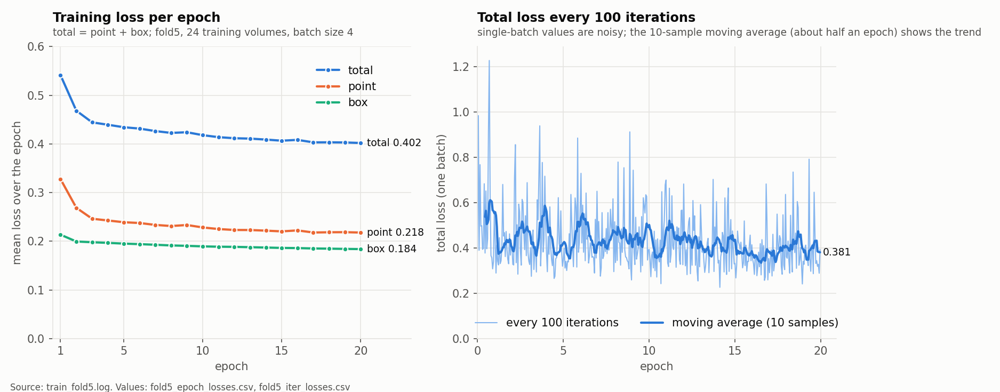

# Run 1 — 5-fold cross-validation baseline

Our fine-tuned model scored 63.70–71.84% four-organ Dice per fold with one box, about 17–25 pp below the paper's 88.33%.

**Goal.** Reproduce the authors' BTCV training as a 5-fold cross-validation, so every one of the 30 patients is tested once by a model that never saw it.

**What was done.** Built five 24/6 train/test splits and checked they don't overlap. Fine-tuned one model per fold for 20 epochs (batch size 4). Scored each fold's 6 held-out patients with one box per organ, using the authors' original evaluator.

**What changed, and why.** Nothing in the method; this run sets the reference every later run is compared with.

**Before.** The authors report 88.33% (one box, paper Table 1). The official pretrained model scored 79.12% on fold 5's patients.

**After (Dice %, 6 patients per fold).**

| Fold | Liver | Stomach | Left kidney | Spleen | Mean |
| --- | ---: | ---: | ---: | ---: | ---: |
| 1 | 74.87 | 57.83 | 70.19 | 76.25 | 69.78 |
| 2 | 68.39 | 57.55 | 61.71 | 67.15 | 63.70 |
| 3 | 77.64 | 61.27 | 69.02 | 79.43 | 71.84 |
| 4 | 77.14 | 63.32 | 69.62 | 75.05 | 71.28 |
| 5 | 79.02 | 61.56 | 67.74 | 76.48 | 71.20 |
| Paper | 95.44 | 74.31 | 92.42 | 91.16 | 88.33 |

**What improved.** Nothing yet; this is the starting point.

**Still not working.**

- Fine-tuning made the model worse on fold 5: 79.12% before training, 70.30% after 5 epochs, 71.20% at epoch 20, even though training loss kept falling.
- The gap to the paper is not explained. Our splits and training history differ from the authors', so it is not a like-for-like comparison.

Fold 5 training loss fell from 0.541 to 0.402 over 20 epochs, while test Dice dropped from 79.12% to 71.20%.

**Key findings.** Stomach and left kidney are the weakest organs in every fold. Fold 2 is the hardest fold. Lower training loss did not mean better test Dice.

Sources: `KT/04_BTCV_5Fold/`, `KT/Early_Finetuning_Audit.md`, `btcv_cross_validation/logs/fold{1-5}_evaluation.json`.
